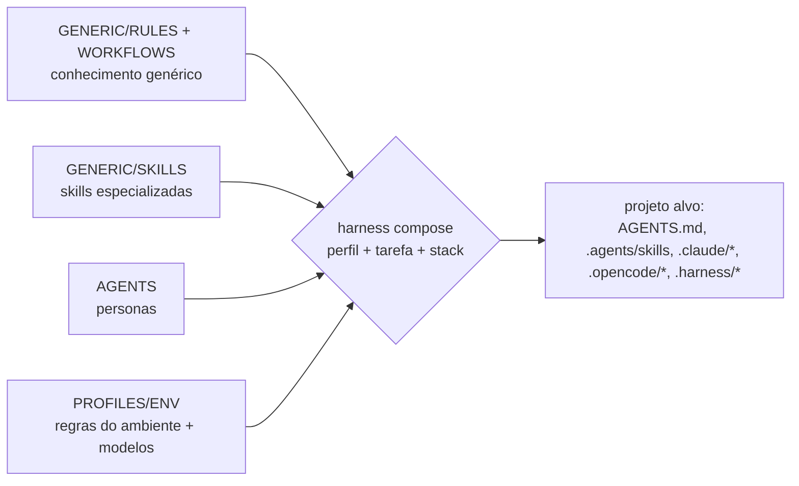

# Arquitetura

## Problema

Os padrões de engenharia estavam espalhados entre o vault pessoal, roles do Maestri e instruções de cada ferramenta, e nada disso podia ser levado ao ambiente corporativo. Além disso, cada ferramenta de IA espera arquivos em lugares e formatos diferentes.

## Pesquisa (2026-10-12)

| Padrão | Situação | Decisão |
|---|---|---|
| [Agent Skills](https://agentskills.io/specification) (`SKILL.md`) | padrão aberto, lido por Claude Code, OpenCode, Devin CLI e Codex. O `name` deve casar com a pasta, `metadata` é um mapa string→string, e existe um validador oficial `skills-ref` | **adotado como formato base de todas as unidades** |
| `AGENTS.md` | instruções sempre ativas do repositório. O Devin CLI, o OpenCode e o Codex leem direto; o Claude Code lê via `CLAUDE.md` com `@AGENTS.md` | destino das **regras** |
| Subagentes (`.claude/agents`, `.opencode/agents`) | Markdown + frontmatter com `model` | destino das **personas** |
| Maestri | canvas de agentes com roles (prompt), recrutas (comando que define o modelo), floors (worktrees), routines e notes. O CLI só funciona dentro dos terminais do Maestri | destino das **personas no canvas**, via script gerado |

`RULE.md`, `WORKFLOW.md` e `AGENT.md` não existem como padrão externo. Por isso eles usam **o mesmo frontmatter das skills**, o que permite um só validador e exportar qualquer unidade como skill.

## Três dimensões

- **Herança**: um perfil só carrega o próprio conteúdo e o dos perfis que lista em `extends`. Os perfis ITAU e PERSONAL não herdam nada um do outro, e os testes garantem isso (`TESTS/test_resolve.py`).
- **Critérios de atualização**:
  - genérico: precisa de fonte pública e vale em qualquer empresa;
  - skill: fonte, licença e revisão periódica (`harness.reviewed`, com aviso depois de 6 meses);
  - perfil: precisa da confirmação do dono, e os valores carregam `confirmed: true/false`.

## Desvios em relação ao rascunho do pedido

- **`ORCHESTRATION/` não existe**: personas (`AGENTS/`) + workflows + o adapter Maestri cobrem esse papel.
- **`ADAPTERS/` virou `TOOLS/harness/adapters.py`**: os adapters são código do CLI, e uma pasta solta de código na raiz complicaria o empacotamento.
- **`EXAMPLES/` e `PROFILE.md` foram acrescentados**.
- **Os nomes de skills são mais específicos**, para seleção precisa (`java-spring-boot` em vez de `java`).

## Decisões

- [ADR-0001: harness canônico e formato Agent Skills](adr/0001-harness-canonico.md)
